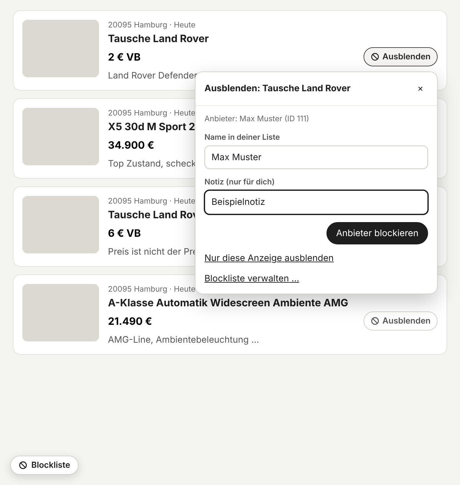
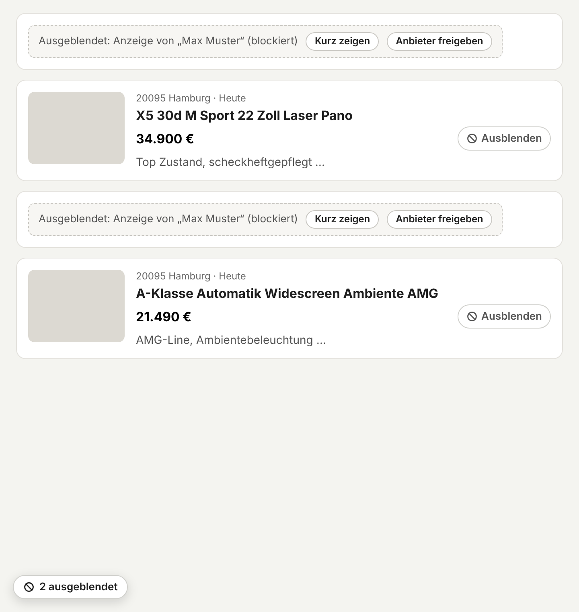
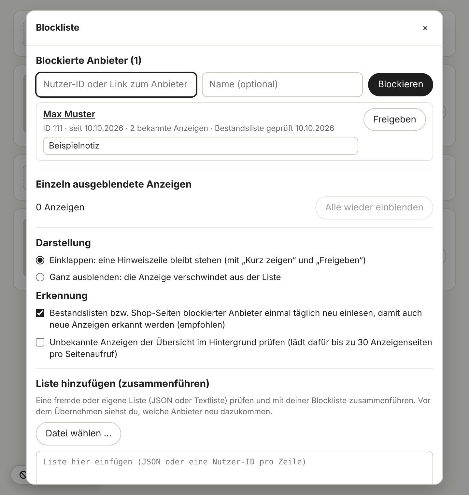
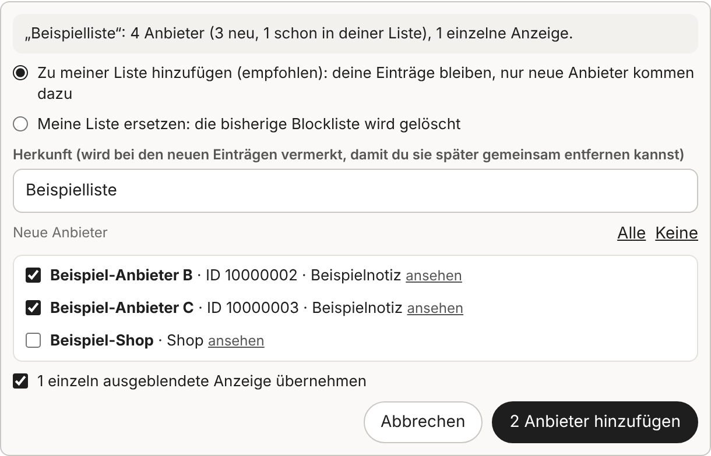

<div align="center">


# 🚫 Kleinanzeigen – Nutzer ausblenden

**Eine eigene Blockliste für Kleinanzeigen.de: Anzeigen von Anbietern, die du blockierst, verschwinden aus deinen Suchergebnissen.**

[](https://github.com/RainbowLabsInc/Kleinanzeigen.de-User_ausblenden/raw/main/script.user.js)
[](https://www.kleinanzeigen.de)
[](#%EF%B8%8F-installation)
[](LICENSE)
[](https://ko-fi.com/rainbowlabsinc)

*Chrome · Firefox · Edge · Kein Server · Kein Tracking · Listen teilen und zusammenführen*

</div>

---

Manche Anbieter tauchen in jeder Suche wieder auf: mit Lockpreisen wie **„2 € VB“**, mit „nur Tausch“-Anzeigen oder mit Dutzenden fast gleichen Inseraten. Kleinanzeigen bietet keine Möglichkeit, diese Anbieter in der Suche auszublenden.

**Dieses Userscript ergänzt eine Blockliste.** Neben dem Preis jeder Anzeige sitzt ein Button „Ausblenden“. Damit blockierst du den Anbieter oder blendest nur diese eine Anzeige aus. Alle Anzeigen blockierter Anbieter werden danach eingeklappt oder verschwinden ganz. Die Liste lässt sich exportieren und weitergeben. Fremde Listen führst du nach einer Vorschau mit deiner eigenen zusammen, ähnlich wie Filterlisten gegen Werbung.

<p align="center">
  
  <br><sub>Das Menü am Button „Ausblenden“ (Darstellung an einer nachgebauten Seite).</sub>
</p>

<p align="center">
  
  <br><sub>Nach dem Blockieren: Beide Anzeigen des Anbieters sind eingeklappt, die anderen bleiben sichtbar.</sub>
</p>

---

## ✨ Features

* 🚫 **Anbieter blockieren:** Ein Klick auf „Ausblenden“ neben dem Preis öffnet ein kleines Menü. Das Script ermittelt den Anbieter, du gibst ihm optional einen Namen und eine Notiz, fertig.
* 🙈 **Einzelne Anzeigen ausblenden:** Wenn dich nur eine Anzeige stört und nicht der ganze Anbieter.
* 📋 **Einklappen oder ganz ausblenden:** Standardmäßig bleibt eine schmale Hinweiszeile mit „Kurz zeigen“ und „Freigeben“ stehen. Wer will, lässt die Anzeigen ganz verschwinden.
* 🔎 **Auch auf der Anzeigenseite:** Am Anbieter-Namen und unten links steht ein Button „Blockieren“, bei privaten wie gewerblichen Anbietern. Bei blockierten Anbietern erscheint unten ein Hinweis.
* 📒 **Verwaltung:** Über den Button „Blockliste“ unten links (oder das Tampermonkey-Menü) siehst du alle blockierten Anbieter mit Notiz, Datum und Zahl der bekannten Anzeigen. Du kannst auch eine Nutzer-ID oder einen Link zum Anbieter (Bestandsliste oder Shop) direkt eintragen.
* 💾 **Export:** als JSON-Datei, als Textliste oder über die Zwischenablage.
* 🔀 **Listen zusammenführen:** Eine fremde (oder eigene) Liste als Datei wählen oder einfügen. Eine Vorschau zeigt, welche Anbieter neu sind und welche du schon hast; einzelne lassen sich abwählen. Übernommene Einträge merken sich ihre **Herkunft**, und mit „Alle freigeben“ entfernst du eine übernommene Liste wieder, ohne deine eigenen Einträge anzutasten.
* 🔄 **Mehrere Tabs:** Änderungen gelten sofort auch in anderen offenen Kleinanzeigen-Tabs.
* 🔒 **Strikt begrenzt:** läuft nur auf `https://www.kleinanzeigen.de` und dort nur auf Seiten unter `/s-…` (Suche, Anzeigen, Bestandslisten).

<p align="center">
  
  <br><sub>Die Verwaltung der Blockliste.</sub>
</p>

---

## ⚙️ Installation

**Schritt 1: Userscript-Erweiterung installieren** (kostenlos)

| Browser | Erweiterung |
|---|---|
| Chrome / Edge | [Tampermonkey](https://chrome.google.com/webstore/detail/tampermonkey/dhdgffkkebhmkfjojejmpbldmpobfkfo) oder [Violentmonkey](https://chrome.google.com/webstore/detail/violentmonkey/jinjaccalgkegednnccohejagnlnfdag) |
| Firefox | [Tampermonkey](https://addons.mozilla.org/de/firefox/addon/tampermonkey/) oder [Violentmonkey](https://addons.mozilla.org/de/firefox/addon/violentmonkey/) |

> **Chrome/Edge:** Bei neueren Tampermonkey-Versionen muss in den Erweiterungs-Details „Benutzerskripte zulassen“ bzw. der Entwicklermodus aktiviert sein.

**Schritt 2: Script installieren**

[](https://github.com/RainbowLabsInc/Kleinanzeigen.de-User_ausblenden/raw/main/script.user.js)

*(Alternativ: Inhalt von `script.user.js` kopieren und in Tampermonkey als neues Skript einfügen.)*

Updates holt sich Tampermonkey automatisch aus diesem Repo. Das Script verträgt sich mit [Kleinanzeigen – Anzeige melden](https://github.com/RainbowLabsInc/Kleinanzeigen.de_Anzeige_melden): Beide Buttons stehen dann nebeneinander in der Preiszeile.

---

## 🛠️ Bedienung

1. Ganz normal auf Kleinanzeigen suchen. Ein Login ist nicht nötig.
2. Bei einer störenden Anzeige neben dem Preis auf **„Ausblenden“** klicken.
3. Im Menü wird der Anbieter ermittelt. Optional Name und Notiz anpassen, dann **„Anbieter blockieren“**. Oder **„Nur diese Anzeige ausblenden“**.
4. Ein Hinweis unten zeigt, wie viele Anzeigen des Anbieters gefunden wurden. Mit **„Rückgängig“** lässt sich das sofort zurücknehmen.

**Freigeben:** in der Hinweiszeile einer eingeklappten Anzeige, im Menü am Button, auf der Anzeigenseite oder in der Verwaltung.

**Fremde Liste hinzufügen:**

1. Unten links auf **„Blockliste“** klicken.
2. Unter **„Liste hinzufügen (zusammenführen)“** eine Datei wählen oder die Liste ins Textfeld einfügen und **„Eingefügte Liste prüfen“** klicken.
3. In der Vorschau prüfen, welche Anbieter neu dazukommen, und bei Bedarf einzelne abwählen. Unter **Herkunft** steht der Name der Liste (aus der Zeile `! Titel:` bzw. dem Dateinamen); er wird bei allen neuen Einträgen vermerkt.
4. **„… Anbieter hinzufügen“** klicken. Deine eigenen Einträge bleiben unverändert, Doppelte werden nur einmal übernommen.

Gefällt dir eine übernommene Liste nicht mehr, entfernst du sie in der Verwaltung unter **„Übernommene Listen“** mit **„Alle freigeben“**. Statt zusammenzuführen kannst du in der Vorschau auch **„Meine Liste ersetzen“** wählen, z. B. um eine eigene Sicherung zurückzuspielen.

<p align="center">
  
  <br><sub>Die Vorschau beim Zusammenführen (Beispieldaten).</sub>
</p>

---

## 🔧 Wie es technisch funktioniert

Kleinanzeigen zeigt in den Suchergebnissen in der Regel nicht an, **wer** eine Anzeige eingestellt hat. Das Script merkt sich deshalb, welche Anzeige zu welchem Anbieter gehört (der **Anzeigen-Index**, lokal gespeichert).

| Situation | Was passiert |
|---|---|
| Klick auf „Ausblenden“ | Das Script lädt die Anzeigenseite, wie beim normalen Öffnen, und liest den Anbieter aus: bei privaten Anbietern aus dem Link zur Bestandsliste (`/s-bestandsliste.html?userId=…`), bei gewerblichen aus dem Link zur Shop-Seite (`/pro/<shop>`). |
| „Anbieter blockieren“ | Bestandsliste bzw. Shop-Seite des Anbieters wird einmal geladen (höchstens 5 Seiten). Alle dort gelisteten Anzeigen kommen in den Index und werden sofort ausgeblendet. |
| Neue Anzeigen eines blockierten Anbieters | Bestandslisten und Shop-Seiten blockierter Anbieter werden höchstens einmal am Tag neu geladen, pro Seitenaufruf für höchstens 3 Anbieter. Das lässt sich in der Verwaltung abschalten. |
| Anzeige oder Bestandsliste öffnen | Die Zuordnung wird nebenbei gelernt, ohne zusätzliche Anfrage. |
| Optional: „Unbekannte Anzeigen im Hintergrund prüfen“ | Standardmäßig **aus**. Wenn eingeschaltet, lädt das Script bis zu 30 Anzeigenseiten pro Seitenaufruf nacheinander (mit Pause), um auch Anzeigen zu erkennen, die in keiner geladenen Bestandsliste standen. |
| Ausblenden | Die Anzeigen-Karte bekommt nur ein Attribut und eine Hinweiszeile. Die Seite selbst wird nicht verändert. Nachgeladene Ergebnisse erfasst ein `MutationObserver`; baut Kleinanzeigen Teile der Seite neu auf, setzt das Script Buttons und Hinweise wieder ein. |

Gespeichert wird im Speicher des Userscript-Managers (`GM_setValue`). Fehlt der, nutzt das Script den `localStorage` von kleinanzeigen.de. Alle Selektoren und Grenzwerte stehen gesammelt im `CONFIG`-Block am Anfang von `script.user.js`.

---

## 📄 Listenformat

Die Blockliste lässt sich in zwei Formaten austauschen. Beide werden beim Import automatisch erkannt.

**Textliste** (ähnlich einer Filterliste, gut zum Pflegen von Hand):

```text
! Titel: Meine Kleinanzeigen-Blockliste
# Kommentarzeilen beginnen mit # oder !; der Titel wird beim Zusammenführen als Herkunft vorgeschlagen
# Eine Zeile pro Anbieter: <Nutzer-ID> [Name] [# Notiz]
12345678 Beispielname  # Beispielnotiz
https://www.kleinanzeigen.de/s-bestandsliste.html?userId=87654321
pro:beispiel-shop
# Einzelne Anzeigen:
anzeige:3500000000
```

* Eine Nutzer-ID ist die Zahl aus dem Link zur Bestandsliste eines Anbieters („Weitere Anzeigen“ auf der Anzeigenseite). Statt der Zahl darf auch der ganze Link in der Zeile stehen.
* `pro:<shop>` steht für gewerbliche Anbieter mit Shop-Seite unter `kleinanzeigen.de/pro/<shop>`. Stattdessen darf auch der Link zur Shop-Seite in der Zeile stehen.
* Ungültige Zeilen werden beim Import übersprungen und gezählt.

**JSON** (vollständig, mit Datum):

```json
{
  "format": "kleinanzeigen-blockliste",
  "version": 1,
  "title": "Meine Kleinanzeigen-Blockliste",
  "exported": "2026-10-10T12:00:00.000Z",
  "users": [
    { "id": "12345678", "name": "Beispielname", "note": "Beispielnotiz", "added": "2026-10-10T11:00:00.000Z" },
    { "id": "87654321", "name": "", "note": "", "added": "2026-10-10T11:30:00.000Z", "source": "Beispielliste" }
  ],
  "ads": ["3500000000"]
}
```

`source` ist optional und steht bei Einträgen, die aus einer anderen Liste übernommen wurden. Die Textliste enthält keine Herkunft.

Beide Formate sind schlichte Textdateien. Eine gemeinsame Liste kann also später einfach als Datei auf einem Server oder in einem GitHub-Repo liegen (siehe [Ideen für später](#%EF%B8%8F-ideen-für-später)).

---

## 🧪 Getestet

| Umgebung | Stand |
|---|---|
| Live-Seite, Tampermonkey | ✅ Suchergebnisse: Button „Ausblenden“ neben dem Preis, auch zusammen mit „Anzeige melden“; Anzeigen blockierter Anbieter eingeklappt |
| Live-Seite, Tampermonkey | ✅ Anzeigenseite eines gewerblichen Anbieters: Anbieter über die Shop-Seite erkannt, beide Buttons bleiben stehen, Shop-Seite lässt sich einlesen |
| Live-Seite | ⏳ Bestandsliste privater Anbieter einlesen, Shops mit vielen Anzeigen, Violentmonkey |
| Chromium mit nachgebauten Seiten | ✅ Blockieren, Einklappen, Ganz ausblenden, Kurz zeigen, Freigeben, einzelne Anzeigen, Anzeigenseite, Bestandsliste, Neuaufbau der Seite, Export, Zusammenführen (Vorschau, Auswahl, Herkunft, Doppelte, „Alle freigeben“, Ersetzen, fehlerhafte Dateien), Speicher über `GM_setValue` und `localStorage` |

Steht in der Verwaltung nach dem Blockieren „0 bekannte Anzeigen“, konnte das Script die Bestandsliste bzw. Shop-Seite nicht einlesen. Dann wird nur die Anzeige ausgeblendet, über die du blockiert hast.

Funktioniert etwas nicht, hilft ein [Issue](https://github.com/RainbowLabsInc/Kleinanzeigen.de-User_ausblenden/issues) mit:

1. einem Screenshot und dem Link zur betroffenen Seite,
2. dem HTML des betroffenen Elements (DevTools → Element → Rechtsklick → *Copy → Copy outerHTML*), z. B. des Anbieter-Kastens auf der Anzeigenseite.

Bitte **keine** Cookies, Tokens oder persönlichen Daten mitschicken.

---

## 📋 Versionen

| Version | Änderungen |
|---|---|
| **0.2.0** | Listen zusammenführen: Vorschau mit Auswahl der neuen Anbieter, Herkunft je Eintrag, „Übernommene Listen“ mit „Alle freigeben“; Doppelte in einer Liste werden nur einmal übernommen |
| **0.1.5** | Aufgeräumt: Kommentare, Texte (Bestandsliste bzw. Shop-Seite), Hilfsfunktionen; Verhalten unverändert |
| **0.1.4** | Shop-IDs wieder einheitlich kleingeschrieben; behebt, dass unter 0.1.2 blockierte Händler mit 0.1.3 nicht mehr als blockiert erkannt wurden |
| **0.1.3** | Gewerbliche Anbieter: Händler-Kasten `#viewad-bizteaser` als bekannter Bereich (Schreibweise der Shop-Adresse beibehalten, in 0.1.4 zurückgenommen) |
| **0.1.2** | Anzeigenseite: zusätzlicher fester Button unten links; Buttons, Hinweise und Styles kommen zurück, auch wenn die Seite größere Teile austauscht |
| **0.1.1** | Buttons und Hinweiszeilen werden wieder eingesetzt, wenn Kleinanzeigen den Anbieter-Kasten oder Karten nach dem Laden neu aufbaut |
| **0.1.0** | Erste Version: Anbieter blockieren, einzelne Anzeigen ausblenden, Einklappen oder ganz Ausblenden, Verwaltung mit Notizen, Export und Import (JSON und Textliste), Anzeigen-Index mit täglicher Aktualisierung |

---

## 🗺️ Ideen für später

* **Gemeinsame Listen abonnieren:** Eine oder mehrere Listen-URLs eintragen (z. B. eine Datei in einem GitHub-Repo), die das Script regelmäßig abruft, ähnlich wie Filterlisten in Werbeblockern. Dafür braucht das Script die Berechtigung `GM_xmlhttpRequest` für die jeweilige Adresse. Abonnierte Einträge würden getrennt von der eigenen Liste geführt, damit man sie einzeln ausnehmen kann.
* Anbieter nach Merkmalen ausblenden (z. B. nur gewerbliche Anbieter, bestimmte Orte).
* Browser-Extension (Chrome/Edge/Firefox) auf Basis desselben Codes.

---

## ⚖️ Disclaimer

> Dieses Skript ist ein inoffizielles Tool und steht in keiner Verbindung zu Kleinanzeigen. Die Nutzung erfolgt auf eigene Gefahr. Blockieren wirkt nur in deinem Browser: Der Anbieter erfährt davon nichts, und seine Anzeigen bleiben für alle anderen sichtbar.

* Übernimm fremde Listen nur aus Quellen, denen du vertraust, und prüfe die Vorschau. Eine Liste ist eine Meinung ihres Erstellers, keine Feststellung von Kleinanzeigen.
* Es liest keine Passwörter oder Nachrichten aus und sendet nichts an fremde Server.
* An Kleinanzeigen stellt es nur lesende Anfragen, wie beim normalen Öffnen einer Seite: die Anzeigenseite beim Klick auf „Ausblenden“ und die Bestandslisten bzw. Shop-Seiten blockierter Anbieter (siehe [Wie es technisch funktioniert](#-wie-es-technisch-funktioniert)).
* Blockliste, Notizen und Anzeigen-Index liegen nur lokal im Speicher deines Userscript-Managers bzw. Browsers.
* Es läuft **ausschließlich auf `https://www.kleinanzeigen.de`**, und dort nur auf Seiten unter `/s-…`. Auf allen anderen Websites ist es inaktiv.
* Aufbau und Teile des Codes (Erkennung der Anzeigen-Karten und der Preiszeile) stammen aus [Kleinanzeigen – Anzeige melden](https://github.com/RainbowLabsInc/Kleinanzeigen.de_Anzeige_melden).

---

## ☕ Unterstütze das Projekt

<a href="https://ko-fi.com/rainbowlabsinc" target="_blank">
  
</a>

Dieses Userscript ist ein kostenloses Open-Source-Hobbyprojekt. Wenn es dir Zeit und Nerven bei der Suche auf Kleinanzeigen spart, freue ich mich über einen Kaffee.

---

## 📄 Lizenz

MIT License: frei nutzbar, veränderbar und weitergebbar. Siehe [LICENSE](LICENSE).

---

<div align="center">

**Made with ❤️ by RainbowlabsInc**

[Installieren](https://github.com/RainbowLabsInc/Kleinanzeigen.de-User_ausblenden/raw/main/script.user.js) · [Issues](https://github.com/RainbowLabsInc/Kleinanzeigen.de-User_ausblenden/issues) · [☕ Spenden](https://ko-fi.com/rainbowlabsinc)

</div>
